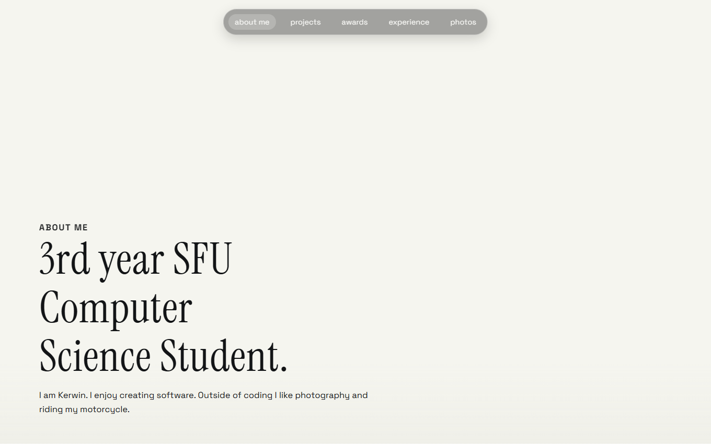
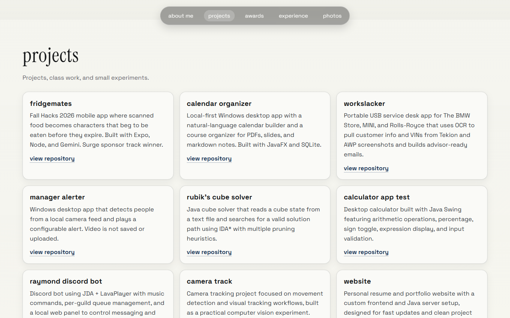
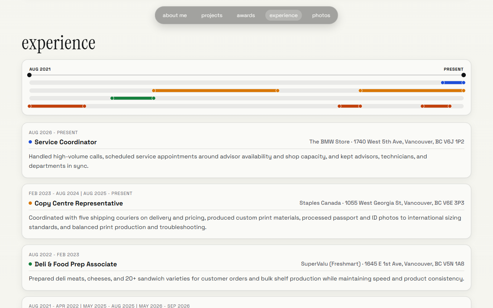

# website

my personal resume and portfolio website hosted at **https://kerwinmok.github.io/website/**. built with plain html, css, and vanilla javascript with no build step, plus a small java http server for local preview.

## screenshots

### home & navigation


### projects grid


### work history timeline & experience


## how it works

1. **section navigation & momentum scroll (`public/app.js`):** overrides native css transitions when a fine pointer is available and drives a frame-rate-independent easing loop (`requestAnimationFrame` + `performance.now()`) with trailing velocity decay, keyboard scroll keys, and click-to-section nav highlighting (`history.replaceState` keeps the url hash synced without polluting browser history).
2. **overlap experience timeline (`public/index.html`, `public/app.js`):** renders a horizontal color-coded timeline spanning from august 2021 to present with month duration tooltips on each bar and live age tooltips calculated from birth date on the start and present endpoints.
3. **project cards & photo lightbox (`public/index.html`, `public/app.js`):** displays featured projects at the top (`fridgemates`, `calendar organizer`, `workslacker`, and earlier apps) and loads photos from `public/assets/photos/` into a clickable lightbox with click-to-zoom and `Esc` close support.
4. **static java server (`server/ResumeServer.java`):** optional lightweight `HttpServer` serving `public/` on port `8080` with path-traversal protection outside `public/`.

## run locally

- **open directly in browser:**
  ```powershell
  powershell -ExecutionPolicy Bypass -File ./scripts/open-static.ps1
  ```
- **run via local java static server (`http://localhost:8080`):**
  ```powershell
  powershell -ExecutionPolicy Bypass -File ./scripts/run-local.ps1
  ```

## photos

drop images into `public/assets/photos/` and list their filenames inside `photoFiles` in `public/app.js`.

live site: https://kerwinmok.github.io/website/
